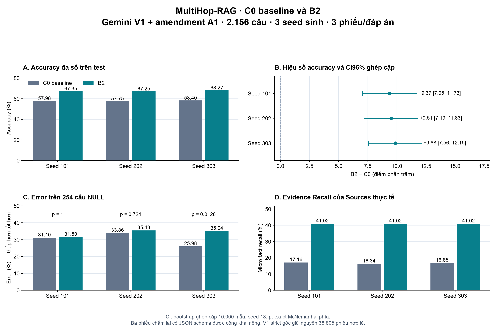

# Kết quả MultiHop RAG Phase 3

## Thiết kế đã đóng băng

- Dữ liệu: corpus MultiHop-RAG gồm 609 tài liệu, index 1.656 chunks do chính Qwen dựng; dev 400 và test 2.156 câu đã chia cố định (seed 13), test có 254 câu Null.
- Mô hình index/sinh đáp án: Qwen/Qwen2.5-3B-Instruct, embedding all-MiniLM-L6-v2; dùng index đóng băng, không xây lại. Ba seed sinh: 101, 202, 303.
- C0: baseline nhóm đã sửa theo manifest. C1/B2: Sources dùng RRF(vector, BM25), k=60, cùng ngân sách Sources 4.000 token; Entities và điều kiện thoát sớm vẫn dùng graph. Đây là phép so cách xếp hạng Sources trong hệ thống, không phải đối chứng bỏ toàn bộ graph.
- Mỗi cấu hình/seed có 2.156 đáp án, ba phiếu Gemini mỗi đáp án. Tổng 12.936 đáp án và 38.808 phiếu trong bản có amendment. Ba slot chấm lại không làm thay đổi đáp án sinh, tập câu hay mẫu số.
- Prompt/parser V1 nguyên gốc, source, manifest và input đều được lưu hash; chỉ ba slot được phép dùng hợp đồng JSON mới ở API. REPRODUCE.txt và RAW_DATA_REFERENCES.json mô tả đường tái lập.

## Kết quả chính

Theo bộ nhãn Gemini V1+A1, B2 có accuracy đa số trung bình67,63% (SD giữa seed 0,56), so với C0 là58,04% (SD 0,33), tăng9,59điểm%. Riêng từng seed tăng9,37/9,51/9,88điểm%; cả3 exact McNemar p<0,05 và CI95% ghép cặp nằm phía dương. Kết luận giữ vững khi thay đổi giả định nhãn đa số của duy nhất query chấm lại.

EvidenceRecall micro trên Sources: B2 đạt41,02%, C0 khoảng16,34–17,16%. Đây là so sánh hệ thống C0/B2; chưa tách riêng đóng góp BM25/vector/Entities/graph trên test.

Cần nêu rủi ro NULL: seed 303 error tăng từ25,98% lên35,04% (+9,06điểm%; p=0,0128), trong khi seed 101/202 chưa có khác biệt có ý nghĩa. Chưa đạt tiêu chí RQ5 tăngerror nhất quán có ý nghĩa cả3 seed; không được suy ra NULL đã an toàn hoặc không có rủi ro.

## Phiên bản đánh giá và xử lý vận hành

Bản này dùng **Gemini V1 + amendment A1 chấm lại3 slot có JSON schema**. Giữ nguyên12.936 đáp án và38.805 phiếu V1 hợp lệ. Ba phiếu mới thuộc C1/B2, seed 101, câu mhr-1114, pass1/2/3, được gọi mới bằng cùng model/rubric/input; không lấy lại nhãn từ phản hồi cũ. V1 strict nguyên gốc vẫn38.805/38.808; bản có amendment đủ38.808/38.808 phiếu.

Người dùng trực tiếp duyệt chấm lại3 slot ngày30/10/2026. Giới hạn6HTTP calls, tối đa2mỗi slot, lấy phiếu đúng schema đầu tiên, không chọn theo nhãn. Ledger ghi dispatch trước gọi và fsync từng phản hồi; lưu riêng toàn bộ raw/receipt/hash. Structured output bảo đảm hợp đồng định dạng được kiểm, không phải bằng chứng nhãn đúng về ngữ nghĩa.

Sự cố vận hành: worker CPU gặp WinError5 khi thay STATUS.json ngày28/10; khôi phục tối đa5lần chỉ đúng lỗi đó và giữ prefix. Fair queue được đổi sang ưu tiên cohort chưa chấm trước retry; payload/phương pháp không đổi. Ngày29/10 tiến trình bị gián đoạn chưa rõ nguyên nhân, khôi phục14:24UTC+7 với78prefix journal nguyên vẹn. Ngày30/10 queue kết thúc needs_adjudication vì3 slot hết32vòng; không reset budget gốc. Đây là sự cố và thay đổi vận hành/đánh giá được công khai, không phải đóng góp phương pháp retrieval.

Thống kê dùng query ghép cặp, exact McNemar hai phía và bootstrap10.000mẫu, seed13, riêng mỗi seed sinh. Không gộp6.468query-seed thành6.468câu độc lập. RQ5 là error trên254 Null; các phân tích loại câu khác là phụ/thăm dò. SD judge và SD giữa seed sinh được báo riêng.

Test 2156 câu; C0/C1; ba seed sinh; ba phiếu Gemini/đáp án.

| Seed | Cấu hình | Accuracy đa số | Error | Neither | Không đa số | Accuracy mean ± SD judge |
|---|---|---:|---:|---:|---:|---:|
| 101 | C0 | 57.98 | 29.17 | 12.62 | 0.23 | 57.79 ± 0.08 |
| 101 | C1 | 67.35 | 26.21 | 6.40 | 0.05 | 67.21 ± 0.47 |
| 202 | C0 | 57.75 | 31.22 | 10.90 | 0.14 | 57.85 ± 0.27 |
| 202 | C1 | 67.25 | 28.15 | 4.31 | 0.28 | 67.36 ± 0.26 |
| 303 | C0 | 58.40 | 29.55 | 11.97 | 0.09 | 58.21 ± 0.29 |
| 303 | C1 | 68.27 | 26.02 | 5.47 | 0.23 | 68.03 ± 0.32 |

| Seed | C1−C0 (điểm %) | Cặp lên/xuống | Exact p | CI95 ghép cặp |
|---|---:|---:|---:|---|
| 101 | +9.37 | 456/254 | 3.09267e-14 | [7.05, 11.73] |
| 202 | +9.51 | 439/234 | 2.283e-15 | [7.19, 11.83] |
| 303 | +9.88 | 436/223 | 7.9968e-17 | [7.56, 12.15] |

## Kết quả theo loại câu

| Seed | Cấu hình | Loại | N | Accuracy | Error | Neither | Không đa số |
|---|---|---|---:|---:|---:|---:|---:|
| 101 | C0 | comparison | 722 | 50.83 | 38.92 | 9.97 | 0.28 |
| 101 | C0 | inference | 688 | 71.51 | 15.55 | 12.79 | 0.15 |
| 101 | C0 | null | 254 | 53.54 | 31.10 | 14.96 | 0.39 |
| 101 | C0 | temporal | 492 | 51.83 | 32.93 | 15.04 | 0.20 |
| 101 | C1 | comparison | 722 | 59.56 | 36.01 | 4.43 | 0.00 |
| 101 | C1 | inference | 688 | 86.92 | 8.72 | 4.36 | 0.00 |
| 101 | C1 | null | 254 | 53.54 | 31.50 | 14.57 | 0.39 |
| 101 | C1 | temporal | 492 | 58.54 | 33.54 | 7.93 | 0.00 |
| 202 | C0 | comparison | 722 | 52.35 | 40.58 | 6.79 | 0.28 |
| 202 | C0 | inference | 688 | 72.09 | 15.99 | 11.92 | 0.00 |
| 202 | C0 | null | 254 | 48.03 | 33.86 | 17.72 | 0.39 |
| 202 | C0 | temporal | 492 | 50.61 | 37.40 | 11.99 | 0.00 |
| 202 | C1 | comparison | 722 | 61.50 | 36.15 | 1.94 | 0.42 |
| 202 | C1 | inference | 688 | 88.52 | 8.28 | 3.05 | 0.15 |
| 202 | C1 | null | 254 | 49.21 | 35.43 | 14.96 | 0.39 |
| 202 | C1 | temporal | 492 | 55.28 | 40.45 | 4.07 | 0.20 |
| 303 | C0 | comparison | 722 | 53.19 | 36.70 | 9.97 | 0.14 |
| 303 | C0 | inference | 688 | 71.95 | 18.17 | 9.88 | 0.00 |
| 303 | C0 | null | 254 | 55.51 | 25.98 | 18.50 | 0.00 |
| 303 | C0 | temporal | 492 | 48.58 | 36.79 | 14.43 | 0.20 |
| 303 | C1 | comparison | 722 | 62.47 | 32.55 | 4.57 | 0.42 |
| 303 | C1 | inference | 688 | 89.53 | 8.43 | 2.03 | 0.00 |
| 303 | C1 | null | 254 | 48.82 | 35.04 | 15.75 | 0.39 |
| 303 | C1 | temporal | 492 | 57.11 | 36.38 | 6.30 | 0.20 |

## Error trên Null

Phép thử phụ RQ5; các phép so khác theo loại câu là mô tả/thăm dò.

| Seed | N Null | Error C0 | Error C1 | Cặp giảm/tăng error | Exact p |
|---|---:|---:|---:|---:|---:|
| 101 | 254 | 31.10 | 31.50 | 33/34 | 1 |
| 202 | 254 | 33.86 | 35.43 | 34/38 | 0.723948 |
| 303 | 254 | 25.98 | 35.04 | 28/51 | 0.0128124 |

## Evidence Recall trên Sources

Loại Null không có evidence nên recall là N/A.

| Seed | Cấu hình | N có evidence | Micro fact recall | Macro fact recall | Đủ toàn bộ evidence |
|---|---|---:|---:|---:|---:|
| 101 | C0 | 1902 | 17.16 | 18.92 | 3.63 |
| 101 | C1 | 1902 | 41.02 | 43.56 | 13.46 |
| 202 | C0 | 1902 | 16.34 | 18.04 | 3.15 |
| 202 | C1 | 1902 | 41.02 | 43.56 | 13.46 |
| 303 | C0 | 1902 | 16.85 | 18.54 | 3.15 |
| 303 | C1 | 1902 | 41.02 | 43.56 | 13.46 |

## Biến động giữa seed sinh

SD này được tính trên accuracy/error đa số của ba seed, riêng với SD judge ở bảng đầu.

| Cấu hình | Accuracy mean ± SD sinh | Error mean ± SD sinh |
|---|---:|---:|
| C0 | 58.04 ± 0.33 | 29.98 ± 1.09 |
| C1 | 67.63 ± 0.56 | 26.79 ± 1.18 |

## Request và độ bao phủ

Đã kiểm 38808 phiếu cuối hợp lệ. Phiếu lỗi được lưu trong journal nhưng không gán thành nhãn.

| Seed | Cấu hình | HTTP sinh / lỗi | HTTP judge / lỗi |
|---|---|---:|---:|
| 101 | C0 | 2156 / 0 | 7581 / 997 |
| 101 | C1 | 2156 / 0 | 7955 / 1109 |
| 202 | C0 | 2157 / 1 | 9379 / 2864 |
| 202 | C1 | 2156 / 0 | 7519 / 937 |
| 303 | C0 | 2156 / 0 | 9434 / 2895 |
| 303 | C1 | 2158 / 2 | 7421 / 807 |

## Ablation dev một seed

| Phép so | Hiệu số accuracy | Exact p | Vai trò |
|---|---:|---:|---|
| C1 vs C0 | +12.50 | 1.87062e-05 | Thăm dò dev |
| C1 vs C2 | +3.50 | 0.179665 | Thăm dò dev |
| C2 vs C0 | +9.00 | 0.00275434 | Thăm dò dev |

RQ2: Xác nhận cải thiện theo tiêu chí ba seed đã đăng ký.

RQ5: Chưa xác nhận error Null tăng theo tiêu chí đã đăng ký; không suy ra không có rủi ro.

Bảng theo bốn loại câu, Null, Evidence Recall micro/macro/đủ toàn bộ facts, SD giữa seed và số đo request/token được lưu trong TEST_RESULTS.json. test_per_question.csv và test_retrieval.csv giữ dữ liệu để tái tính.

Ablation C1/C2 và C2/C0 thuộc dev một seed; kết quả test chỉ xác nhận C1/C0. Các file dev đính kèm giữ nguyên hash và vai trò thăm dò.

## Giới hạn

- Ba phiếu C1_s101/mhr-1114 được chấm lại bằng cùng Gemini và rubric, với JSON schema theo amendment được user duyệt sau test. V1 strict gốc vẫn thiếu3 phiếu; không gọi bản có amendment là V1 nguyên gốc hoàn tất.
- Gemini latest là alias có thể đổi revision; chưa có nhãn người độc lập kiểm chuẩn, đặc biệt rubric Null còn hạn chế.
- C0 là baseline nhóm đã sửa, không phải tái tạo nguyên bản paper. Xếp hạng graph của C0 vẫn có dense-chunk bonus, không phải strict graph-only.
- C2/C3 chỉ chạy dev một seed. Test này chỉ so C0/B2, chưa đo đóng góp từng kênh hoặc toàn bộ graph trên MultiHop.
- Evidence Recall đo Sources thực sự đưa vào context, không đo độ trung thành lời giải hay toàn bộ thông tin Entities.
- Dev/test dùng chung corpus. Đây không phải phép kiểm tổng quát hoá sang các tài liệu hoàn toàn chưa thấy.
- Thời gian context dùng chung prefix không phải latency retrieval độc lập từng cấu hình. Tổng latency HTTP không phải wall-time hay tiền GPU.
- Chưa có billing cloud thực để xác nhận chi phí cuối. Cap8h là cumulative client Qwen-stage wall, không phải billing. Không có lần mua credits hoặc nâng paid tier trong luồng này.

## Độ nhạy với trường hợp chấm lại

Một query ở seed 101 có thể làm accuracy thay đổi tối đa0,04638điểm% hoặc error trên254 Null tối đa0,39370điểm%. FORMAT_AMENDMENT_SENSITIVITY.json liệt kê cả4khả năng đa số (accurate/error/neither/no_majority) và exact McNemar tương ứng; đây là giả định độ nhạy, không gán chúng thành nhãn thật.

## Thời gian, token và dự toán

| Pha | HTTP attempts | HTTP thành công | HTTP lỗi | Prompt token quan sát | Output token quan sát |
|---|---:|---:|---:|---:|---:|
| keywords | 6789 | 6468 | 321 | 15748599 | 361517 |
| generation | 12939 | 12936 | 3 | 54212527 | 3495321 |
| judge | 49289 | 39680 | 9609 | 18199221 | 202184 |

Qwen cumulative client-stage wall: 3.392giờ, trần8 giờ. Từ mở Phase3 đến nhận3 phiếu mới: 67.90giờ lịch, gồm CPU/chờ quota/gián đoạn. Đây không phải GPU billing. Dự toán trần lịch sử theo giả định đã lưu: 944,864VND trên ngân sách1.000.000VND; chưa có hoá đơn thực để xác nhận chi phí cuối. Không dùng các giả định tỷ giá/đơn giá lịch sử như báo giá hiện tại.

Usage thiếu ở request lỗi được ghi là chưa biết, không phải0. Shared keyword requests tính một lần mỗi seed. EFFICIENCY_AND_BUDGET.json giữ số đo, giả định và nguồn dự toán đầy đủ.

## Kiểm toán và độ nhạy

Toàn bộ109 journal JSONL chuẩn trong runroot đã được kiểm đủ dòng JSON và lưu SHA256/byte-length trong RAW_DATA_REFERENCES.json; các thư mục tmp không chuẩn được liệt kê riêng. Toàn bộ6 judge journals V1, nguồnE,7file package và RUN_MANIFEST giữ nguyên hash.

Với cả4khả năng đa số cho câu chấm lại, hiệu số accuracy seed 101 nằm trong[9.3692;9.4156]điểm%; cùng chiều dương và exactMcNemar p<0,05 trong mọi trường hợp: True. Đây là kiểm độ nhạy cho1query, không thay nhãn quan sát.

Hiệu số accuracy hiển thị được tính từ số cặp lệch trước khi làm tròn; trường diff_from_rounded_rates_pp giữ cách hiển thị pipeline cũ. Phép thử và bootstrap không đổi.

## Tái lập và tệp bàn giao

Code đã push nhánh codex/mhr-phase3-acceleration, commit b640765fb6ac46a817d3d221e2d652240f9e0c6c. REPRODUCE.txt chứa lệnh; TEST_RESULTS.json là kết quả máy đọc, quality_metrics/paired_comparisons/evidence_recall/efficiency/coverage.csv là bảng tách. test_per_question.csv và test_retrieval.csv cho phép tái tính từng câu. RAW_DATA_REFERENCES.json và ANALYSIS_COMPLETED.json lưu đường dẫn/hash. Biểu đồ PNG/SVG ở figures/MULTIHOP_PHASE3_C0_B2.*.

